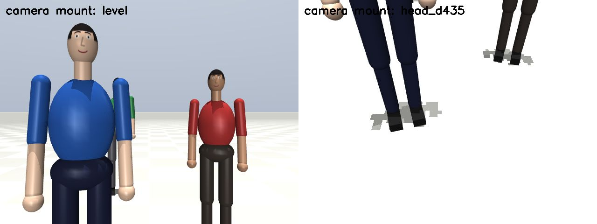

# exp05 vision (2.3): people around the robot

Detects people with the camera, tells whether each one faces the robot, measures their distance with the head
lidar (MID-360) and their walking speed. It publishes this for other modules (behaviour state machine, 2.2
listener, pointing safety). Vision only **reports**: it does not decide what the robot does.

Status 2026-11-13: done and checked **in simulation** (`tools/vision_check.py` 28/28). Not yet run on the real G1.
Read [Camera on the real robot](#camera-on-the-real-robot) before trying it there.

## Run

```bash
cd ~/robotics-simulation/exp05 && ./run_sim.sh          # the exp05 stack first (robot sim + server :8100)
cd vision && ./run_vision.sh                            # sensor sim (people, lidar, camera) + vision on :8107
# open http://localhost:8107/  (camera with boxes, top view, table of people, live events)
./run_vision.sh robot      # real G1: Unitree's head camera (PC2 :8000) + MID-360 via exp04 lidar_relay.sh (UDP 56301)
./run_vision.sh webcam     # laptop webcam only, no lidar (distance from the image: rough)
PRESENCE=1 ./run_vision.sh # also tell the 2.2 listener "a customer is in front" (POST :8100/api/listen/presence)
```

Stop with Ctrl+C, or `kill -INT` the `bash ./run_vision.sh` process. Logs go to `exp05/logs/vision_<time>/`.
Environment options are listed at the top of `run_vision.sh` (`CAMERA`, `CAMERA_MOUNT`, `HFOV`, `MODEL`, `CPU`,
`SHOP`, `SCENARIO`).

Setup (once): `cd vision && ../../tools/uv sync` (after `source ~/robotics-simulation/env.sh`). Models, 44 MB in
`models/`:

| File | Source | Licence |
|---|---|---|
| `pose_landmarker_full.task` (also `lite`, `heavy`) | `https://storage.googleapis.com/mediapipe-models/pose_landmarker/pose_landmarker_full/float16/latest/pose_landmarker_full.task` | Apache-2.0 (MediaPipe) |
| `face_detection_yunet_2023mar.onnx` | `https://github.com/opencv/opencv_zoo/raw/main/models/face_detection_yunet/face_detection_yunet_2023mar.onnx` | MIT |

The GPU is optional. The pose model runs on the GPU delegate when available: ~25 ms per frame on the RTX 4060, but
~100–400 ms while the AI service is busy on the same GPU. The CPU (`CPU=1`) takes ~90–170 ms. No GPU memory to
speak of.

## Interface (port 8107)

| | |
|---|---|
| `GET /people` | `{"time", "people": [...], "proximity": {...}, "events_seq"}`, confirmed people sorted by distance; `?all=1` adds unconfirmed tracks |
| `GET /events?after=N&wait=S` | events with `seq > N`, long poll up to S s (max 30): `{"events": [...], "seq"}` |
| `GET /status` | sources, rates, detector time, joint source, presence bridge |
| `GET /`, `/frame.jpg`, `/top.jpg`, `/debug` | debug page, annotated camera image, top view, last clusters + detections |

A person (robot frame: x ahead, y to the robot's left, metres; bearing in degrees, positive to the left, the same
frame as `pointing.py` and `shop.json`):

| Field | Meaning |
|---|---|
| `id` | track id, stable while the person stays visible to the lidar or the camera |
| `x`, `y`, `distance_m`, `bearing_deg` | body centre; distance from the robot's centre (pelvis axis) |
| `gap_m` | nearest lidar point of that person (for the arm-safety distance) |
| `speed_mps`, `vx`, `vy`, `heading_deg` | walking speed and direction (Kalman filter on the lidar track) |
| `radial_mps`, `approaching`, `moving` | radial speed (negative = coming closer); `approaching` = radial < −0.25 m/s; `moving` = speed > 0.3 m/s |
| `facing` | `true` / `false` while the camera sees the person (a frontal face, head turned < 40°); `null` = cannot tell (outside the camera view, too close for the camera) |
| `head_yaw_deg`, `body_yaw_deg`, `face_score` | head turn from the face, body turn from the 3D pose (front/back unreliable), face detector score |
| `source` | `lidar+camera`, `lidar` (outside the camera or not detected this frame), `camera` (no lidar match) |
| `confirmed` | seen by the camera at least once, or walked > 0.6 m (a person, not a pole or a shelf) |
| `in_camera_view`, `seen_by_camera` | inside the image now / ever seen by the camera |
| `near`, `near_s`, `still_s`, `age_s`, `last_seen_s` | inside the near zone (2 m) and for how long; standing still for how long |

`proximity`: `{"too_close": bool, "nearest_m": {"front", "left", "back", "right"}, "close_m": 1.0}`. Nearest
non-static lidar cluster per 90° sector, robot removed, walls and booths excluded.

Events (each has `seq`, `type`, `time`, and `id` + `person` = the fields above, except too_close/clear):

| Event | When |
|---|---|
| `person_new` | a track is confirmed |
| `person_facing` / `person_not_facing` | starts / stops facing the robot, within 3.5 m |
| `person_near` / `person_far` | enters 2.0 m / leaves 2.3 m |
| `person_dwell` | in the near zone and slower than 0.3 m/s for 2 s (once per visit) |
| `person_left` | the track is lost (> 1.2 s unseen) |
| `too_close` (`sectors`) / `clear` | anyone within 1.0 m of the robot / nobody within 1.2 m for 1 s |

Example for the state machine (other module):

```python
seq = 0
while True:
    r = requests.get(f"http://127.0.0.1:8107/events?after={seq}&wait=10").json()
    for e in r["events"]:
        seq = e["seq"]
        if e["type"] == "person_near" and e["person"]["facing"]:
            requests.post("http://127.0.0.1:8100/api/intro", json={"lang": "th"})
```

## How it works

```
camera frame ─ MediaPipe pose (≤ 6 people) ─ head crop ×N ─ YuNet face ─► box, bearing wedge, facing, head yaw
MID-360 0.1 s frame ─ robot frame (mount + waist yaw from :8100) ─ remove the robot's own body (posed model)
                    ─ keep 0.25–2.1 m above the floor ─ background map (static cells) ─ 5 cm grid clusters
fusion 10 Hz: each camera person ↔ the lidar cluster in its bearing wedge (distance from the lidar)
              unmatched person-sized moving clusters → lidar-only tracks (beside/behind the robot)
Kalman tracks (x, y, vx, vy) ─► people, speeds, facing (held 1.2 s) ─► events, proximity
```

- **Geometry** (`geometry.py`): exp05's G1 model standing at the origin, waist + arms from `GET :8100/api/status`
  (rest pose if the server is not running). The lidar mount is exp04's, checked on our robot on 2026-10-30
  (upside down, 0.45 m above torso_link, 1.28 m above the floor in the model; 1.29–1.31 m measured).
- **Self filter**: lidar points inside any posed robot geom (+4 cm) are removed. In the sim this removes 100 % of the
  robot's own returns (rest, pointing, wai) and nothing else.
- **Background** (`lidar.py`): a 10 cm occupancy average over ~10 s. Cells under confirmed people are not
  learned. Points on static cells are clustered separately, so a person next to a booth is not merged into it.
- **Facing**: the pose model alone cannot tell a back from a front. A frontal face on the upscaled head crop can.
  Head yaw = nose offset / eye distance (YuNet landmarks).
- **Lag**: measurements are stamped with the lidar frame time, and the output is extrapolated to "now" (≤ 0.4 s).

## Checks

```bash
cd exp05/vision && .venv/bin/python tools/vision_check.py      # ~2 min; own processes on free ports
```

2026-11-13, 28/28, with the user's stack running on the same GPU:

| Case | Result |
|---|---|
| customer walks up (1 m/s), waits 6 s facing | confirmed at 6 m in 0.6 s; events new → facing → near → dwell; distance error 2 cm, bearing 0.7°, speed 0.97 m/s, radial −0.96, facing 22/22, one id |
| person with the back to the robot | tracked, facing false 24/24, no facing event |
| passer-by at 3 m, 1.4 m/s | speed 1.41, distance error 0.12 m while walking, not approaching, no near/facing event |
| side visitor to 0.8 m (outside the camera) | lidar track, facing null, distance error 9 cm, `too_close` left, then `clear` |
| two people side by side at 2.5 m | 2 tracks 19/19, both facing 19/19 |
| nobody, arms pointing into the lidar view | no track, no too_close |
| real video (example presenter) | person 30/30 frames, facing 28/30 |

`tools/render_mounts.py` renders `docs/camera_mounts.jpg` (what each camera mount sees).

The sensor sim (`sim_sensors.py`, port 8110, lidar UDP 56305) does not change exp05's `sim_robot.py`. It builds the
same robot, mirrors its joints from :8100, adds the shop booths and up to 6 mannequins (`mannequin.py`, drawn face
on the front of the head) that follow a scenario (`SCENARIOS` or `POST /scenario`), raycasts a MID-360 pattern and
renders the camera. `GET /truth` gives the true positions.

## Camera on the real robot



Unitree's URDF puts the head D435i (`d435_joint`) **47.6° down**. If our robot matches, the head camera sees the
floor and people's legs only (right image), so it cannot find faces and `facing` stays `null`. Distance, speed,
proximity and lidar tracking still work without the camera. Options, in order of effort:

1. Check one image from the real head camera (exp02/exp04 UI, camera "head color"). If it looks level enough, run
   `CAMERA_MOUNT=x,y,z,roll,pitch,yaw ./run_vision.sh robot` with the measured pitch.
2. Add a level USB camera on the head (or chest). See [Option 2 in detail](#option-2-in-detail-a-level-usb-camera).
3. Only if the robot owner agrees: re-aim the D435i.

### Option 2 in detail: a level USB camera

A second, ordinary camera next to the head D435i that looks straight ahead and is used only for detection and
facing. Distance still comes from the lidar, so the camera needs no depth.

- **Camera**: a plain USB (UVC) webcam, 720p 30 fps, about 70–90° field of view (Logitech C920/C930e class or a
  small Arducam UVC board camera). These work with OpenCV on Linux without drivers. Avoid fisheye (> 120°): faces get
  small and distorted, and the code assumes a normal lens. A RealSense also works but its depth is not needed.
- **Place**: on top of or in front of the head, about 1.25–1.35 m above the floor, looking level (`level`: faces
  from ~1.2 m to 6 m and more) or 10° down (`tilt10`: better at 1–1.5 m, cuts tall people far away). A chest mount
  (~1.0–1.1 m) works too, but the arms pass in front of it during pointing and the wai. Use a 3D-printed or clamp
  bracket with no screws into the robot, and route the cable along the neck or back, away from the arms.
- **Connect**:

  | Route | How | Notes |
  |---|---|---|
  | A. USB to the laptop (recommended first) | `CAMERA=webcam:N ./run_vision.sh robot` | the robot stands still at the entrance, so an active USB extension (5–10 m) along the floor works. Nothing changes on PC2 |
  | B. USB to PC2 | exp04's `camera_streamer.py --device N` on PC2, then `CAMERA=http://192.168.123.164:8093/color.jpg ./run_vision.sh robot` | no cable to the laptop. PC2 is shared: needs the other team's OK; stop the streamer after each session |

- **Set it up** (~10 min): measure the camera's position and angle on torso_link and pass
  `CAMERA_MOUNT=x,y,z,roll,pitch,yaw` (metres, degrees) and `HFOV=<horizontal field of view>`. A few cm / degrees
  of error is fine: the lidar decides the distance, the camera only the direction and facing. Check on the page
  (http://localhost:8107/): stand at 1, 2 and 3 m in front of the robot. Your camera box and the lidar cluster
  should agree (top view, `source` = `lidar+camera`).
- **Not built yet** (possible next steps): auto-calibration of the camera's yaw/pitch from a person walking in front
  (camera bearing vs lidar), and a ready-made preset for the chosen mount.

Robot mode also needs exp04's `lidar_relay.sh start` on PC2 (PC2 is shared: `stop` at the end, see exp04 docs),
and exp04's server must not be running on the same laptop (both use UDP 56301).

## Limits and open points

- Not run on real data yet. Expect more false clusters (bags, trolleys, children, glass) and a self-filter margin
  to tune (cables, the real hands).
- Lidar-only tracks need 0.6 m of walking to count as people. A person standing still beside the robot who was
  never seen by the camera is not confirmed (`too_close` still fires).
- A person standing still for > 10 s who is not confirmed becomes background.
- Groups very close together (< ~0.3 m) merge into one lidar cluster. The camera still separates them, but they share
  one distance.
- Privacy: no image is stored. `/frame.jpg` shows the live camera on 127.0.0.1 only (`--host 0.0.0.0` exposes it on
  the network). No face recognition (see `research/2.3_human_detection.md`, PDPA).
